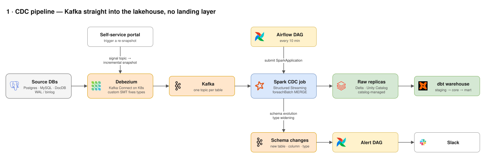
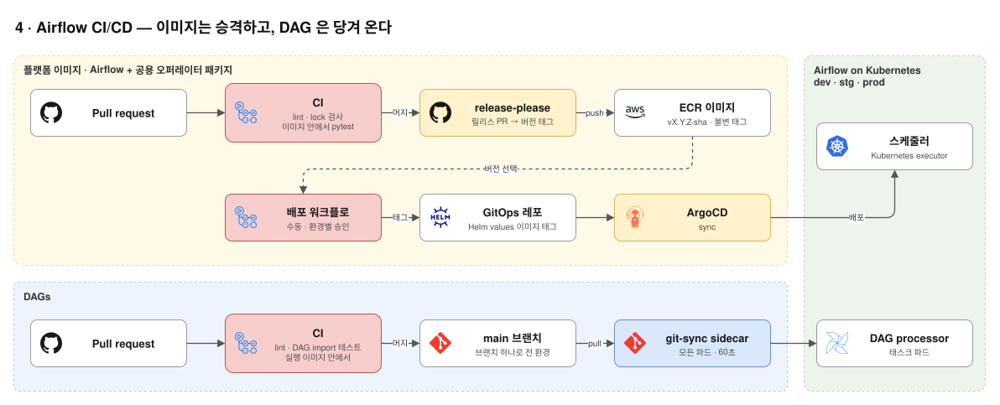

# 장성태 (mungiyo)

**데이터 엔지니어** — 데이터 플랫폼을 만들고 운영합니다. Kafka 기반 CDC 수집, Airflow 오케스트레이션, 레이크하우스 서빙을 다룹니다.

[블로그](https://mungiyo.tistory.com/)

## 만든 것들

그림의 번호는 아래 항목과 같습니다.

<b>1 · CDC 파이프라인</b> — 랜딩 없이 Kafka 에서 레이크하우스로 바로

 

- Spark 잡 하나가 10분마다 Debezium 토픽을 Delta 복제본에 바로 MERGE 합니다. 중간 랜딩 테이블과 중복 제거 단계를 없앴습니다.
- 스키마 변경(새 테이블, 새 컬럼, 넓어진 타입)은 잡이 직접 반영하고 토픽으로 알립니다. 깨진 모델을 보고서야 알게 되는 일이 없습니다.
- 재스냅샷은 요청 티켓이 아니라 셀프서비스 포털의 버튼입니다.

<b>2 · feach</b> — 피처 스토어: 쓰기는 파이프라인, 읽기는 API 하나

 

- 배치 피처: Airflow 오퍼레이터가 dbt 마트의 Delta 두 버전을 비교해, 바뀐 행만 온라인 스토어에 upsert 합니다.
- 실시간 피처: 세션 클러스터 하나에서 도는 Flink 잡들이 CDC·이벤트 토픽을 받아 upsert 합니다. 가공이 필요 없는 테이블은 Kafka Connect JDBC sink 가 그대로 복사합니다.
- feach 는 계약을 보관하고 조회만 서빙합니다. 데이터를 옮기지 않으므로 테이블마다 쓰는 주체가 하나뿐입니다.

<b>3 · dbt CI/CD</b> — 커밋 SHA 하나가 이미지와 DAG 그래프를 함께 가리킨다

 

- PR 에서는 바뀐 모델만 PR 전용 스키마에 빌드하고, 나머지는 운영 테이블을 참조합니다.
- 머지하면 프로젝트를 이미지로 굽고, manifest 를 올린 뒤, 포인터를 바꿉니다. 이 순서라서 포인터가 아직 없는 산출물을 가리키는 일이 없습니다.
- Airflow 는 그 manifest 로 DAG 을 그리고 그 이미지로 dbt 를 실행합니다. 그래프와 실행 코드가 어긋날 수 없습니다.
- 관련 기여: [astronomer/astronomer-cosmos#2815](https://github.com/astronomer/astronomer-cosmos/pull/2815)

<b>4 · Airflow CI/CD</b> — 이미지는 승격하고, DAG 은 당겨 온다

 

- 플랫폼 이미지는 release-please 로 버전을 매기고, GitOps 레포의 태그 변경과 ArgoCD 로 환경마다 승격합니다.
- DAG 은 이 과정을 거치지 않습니다. 모든 파드가 git-sync sidecar 로 `main` 을 당겨 오므로 DAG 변경은 1분 안팎이면 반영됩니다.
- DAG import 테스트는 실제 실행 이미지 안에서 돕니다.
- 관련 기여: [apache/airflow#73517](https://github.com/apache/airflow/pull/73517)

## 기술 스택

- **수집** — Kafka Connect 위 Debezium CDC, 자체 SMT, Iceberg sink
- **처리** — Spark (Kubernetes 위 Spark Connect), Flink, dbt
- **오케스트레이션** — Kubernetes 위 Airflow 3, Cosmos 로 dbt 실행
- **서빙** — Databricks (Delta, Unity Catalog), 피처 스토어
- **플랫폼** — Kubernetes, ArgoCD, Terraform, OpenMetadata

## 오픈소스 기여

- [apache/airflow#73517](https://github.com/apache/airflow/pull/73517) — S3 원격 태스크 로그를 스트리밍으로 읽기 (최대 힙 1,169 → 30 MiB)
- [astronomer/astronomer-cosmos#2815](https://github.com/astronomer/astronomer-cosmos/pull/2815) — dbt partial-parse 캐시를 원자적으로 쓰기
- [datahub-project/datahub#5918](https://github.com/datahub-project/datahub/issues/5918) — Tableau 수집 버그 리포트
