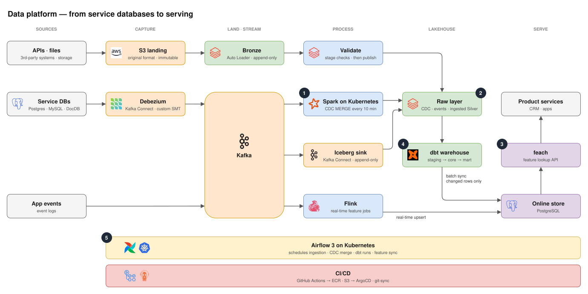
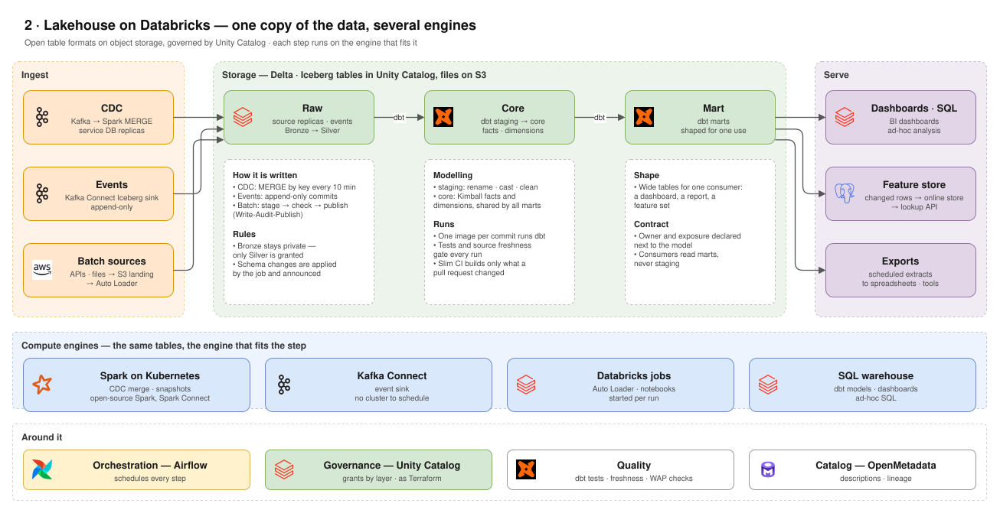
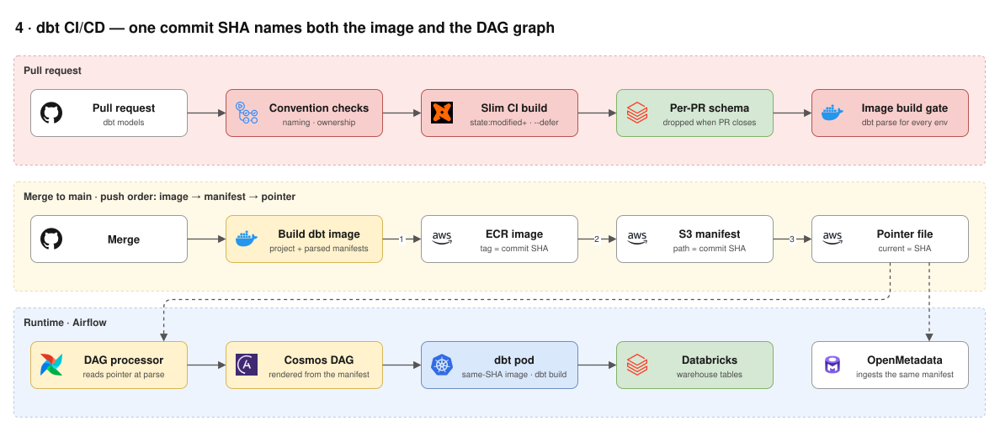

# 장성태 (mungiyo)

**Data Engineer** — 데이터 플랫폼을 만들고 운영합니다. CDC 와 배치 수집으로 Databricks Lakehouse 를 채우고, Airflow 로 워크플로를 돌리고, 그 위에서 피처를 서빙합니다.

## 만든 것

그림의 번호는 아래 섹션 번호와 같습니다.

<b>1 · CDC 파이프라인</b> — Kafka 에서 Lakehouse 로 바로, 중간 적재 계층 없음

 

- Spark 잡 하나가 10분마다 Debezium 토픽을 Delta 리플리카에 바로 MERGE 합니다. 중간 적재 테이블과 중복 제거 단계를 없앴습니다.
- 스키마 변경(새 테이블 · 새 컬럼 · 타입 확장)은 잡이 직접 적용하고 토픽으로 알립니다. 모델이 깨진 뒤에야 알게 되는 일이 없습니다.
- 재스냅샷은 티켓이 아니라 셀프서비스 포털의 버튼으로 실행합니다.

<b>2 · Databricks 기반 Lakehouse</b> — 데이터는 한 벌, 엔진은 여럿

 

- **스토리지** — Unity Catalog 가 관리하는 Delta · Iceberg 테이블이고 파일은 S3 에 있습니다. 기본은 Delta, Databricks 밖의 엔진이 쓰는 테이블은 Iceberg 입니다. 데이터는 Raw(Bronze → Silver) → Core → Mart 세 계층을 거칩니다.
- **컴퓨트** — 테이블은 함께 쓰고 엔진은 단계마다 고릅니다. CDC MERGE 는 Kubernetes 위의 오픈소스 Spark, 이벤트 적재는 Kafka Connect, Auto Loader 는 Databricks job, dbt 모델과 조회는 SQL warehouse 가 맡습니다.
- **처리 구조** — CDC 는 10분마다 키 기준으로 MERGE 하고, 이벤트는 append 하고, 배치 소스는 검사를 통과한 배치만 반영합니다. 그 위에서 dbt 가 staging → core → mart 를 만들고, 테스트와 source freshness 를 통과해야 다음 단계로 넘어갑니다.
- **서빙** — mart 는 대시보드와 애드혹 SQL, 바뀐 행만 온라인 스토어로 동기화하는 피처 스토어, 예약 내보내기로 나갑니다. 접근 권한은 계층별로 주고 Terraform 으로 관리합니다.

**수집** — 모든 배치 소스가 같은 방식으로 들어옵니다.

- CDC 가 아닌 모든 소스(외부 API · 파일 · 외부 스토리지)는 같은 파이프라인을 탑니다: S3 landing → Bronze → 검증 → Silver. 소스를 추가하는 일은 새 코드가 아니라 파이프라인 인스턴스 하나를 더 만드는 일입니다.
- landing 파일은 덮어쓰지 않고 Bronze 는 모든 컬럼을 STRING 으로 보관합니다. 그래서 Silver 는 받은 원본에서 언제든 다시 만들 수 있습니다.
- Write-Audit-Publish: 배치마다 stage 테이블에서 먼저 타입을 변환하고 중복을 없애고 검사합니다. 통과한 배치만 반영하는데, 기본은 범위 교체이고 필요하면 트랜잭션 안에서 키 MERGE 를 합니다. 실패한 배치는 격리하고 Silver 는 건드리지 않습니다.

<b>3 · feach</b> — 피처 스토어: 파이프라인이 쓰고, API 하나로 읽는다

 

- 배치 피처: Airflow operator 가 dbt mart 의 Delta 두 버전을 비교해 바뀐 행만 온라인 스토어에 upsert 합니다.
- 실시간 피처: 세션 클러스터 하나에서 도는 Flink 잡들이 CDC · 이벤트 토픽을 읽어 upsert 합니다. 계산 없는 테이블 복제는 Kafka Connect JDBC sink 가 맡습니다.
- feach 자체는 계약을 보관하고 조회를 서빙할 뿐 데이터를 옮기지 않습니다. 그래서 모든 테이블의 writer 는 정확히 하나입니다.

<b>4 · dbt CI/CD</b> — 커밋 SHA 하나가 이미지와 DAG 그래프를 함께 가리킨다

 

- Pull request 는 바뀐 모델만 임시 스키마에 빌드하고, 나머지는 운영 테이블을 참조(defer)합니다.
- 머지하면 프로젝트를 이미지로 굽고, manifest 를 올리고, 포인터를 바꿉니다. 이 순서라서 포인터가 아직 없는 것을 가리키는 일이 없습니다.
- Airflow 는 그 manifest 로 DAG 을 그리고 그 이미지로 dbt 를 실행합니다. 그래프와 코드가 어긋날 수 없습니다.
- 관련 기여: [astronomer/astronomer-cosmos#2815](https://github.com/astronomer/astronomer-cosmos/pull/2815)

<b>5 · Airflow 기반 Workflow 플랫폼</b> — 들어오는 길은 여럿, 런타임은 하나

 

- 워크플로는 세 갈래로 들어옵니다: 한 레포에 머지되는 직접 작성한 DAG, UI 나 서비스가 오브젝트 스토리지에 쓰는 스펙(스펙마다 DAG 하나), manifest 로 그려지는 dbt DAG 파일.
- 모든 DAG 은 따로 요청하지 않아도 같은 플랫폼 계층을 받습니다: cluster policy(timeout · 태그 · pool · 실패 콜백), 공용 operator, 외부 저장소의 시크릿, 오브젝트 스토리지에 쌓이는 XCom 과 태스크 로그.
- 태스크가 어디서 돌지는 DAG 에 적지 않습니다. 태스크가 자신의 메모리 · CPU · 대기 시간을 보고하고, 배치 정책이 그 실측값으로 리소스를 정하며 태스크마다 파드를 띄울지 상주 Celery worker 로 보낼지를 고릅니다.
- 배포 경로는 둘로 나뉩니다. 플랫폼 이미지는 버전을 붙여 GitOps · ArgoCD 로 환경마다 승격하고, DAG 은 파드마다 붙은 git-sync sidecar 가 당겨 와 약 1분 안에 반영됩니다.
- 테이블이 Airflow Asset 이라서 DAG 은 데이터를 기준으로 스케줄되고, 계보는 메타데이터 카탈로그로 흘러갑니다.
- 관련 기여: [apache/airflow#73517](https://github.com/apache/airflow/pull/73517) — S3 태스크 로그 스트리밍 리더

## Tech Stack

- **수집** — Kafka Connect 위의 Debezium CDC, 커스텀 SMT, Iceberg sink
- **처리** — Spark (Spark Connect on Kubernetes), Flink, dbt
- **오케스트레이션** — Airflow 3 on Kubernetes, Cosmos 로 dbt 실행
- **Lakehouse** — Databricks (Delta, Iceberg, Unity Catalog), SQL warehouse, Auto Loader
- **서빙** — PostgreSQL 기반 피처 스토어, 대시보드
- **플랫폼** — Kubernetes, ArgoCD, Terraform, OpenMetadata

## 오픈소스 기여

- [apache/airflow#73517](https://github.com/apache/airflow/pull/73517) — S3 원격 태스크 로그를 스트리밍으로 읽기 (최대 힙 1,169 → 30 MiB)
- [astronomer/astronomer-cosmos#2815](https://github.com/astronomer/astronomer-cosmos/pull/2815) — dbt partial-parse 캐시를 원자적으로 쓰기
