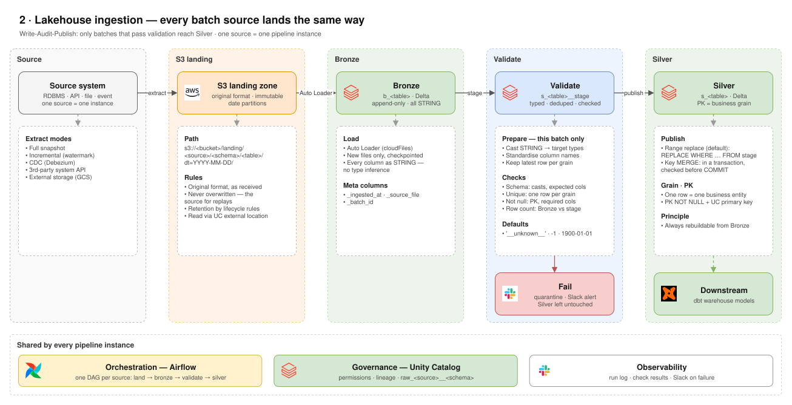
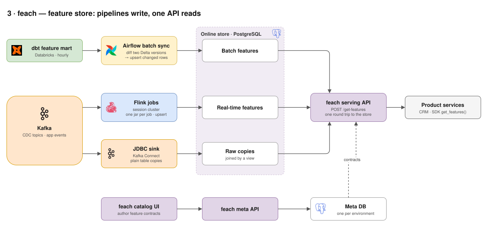
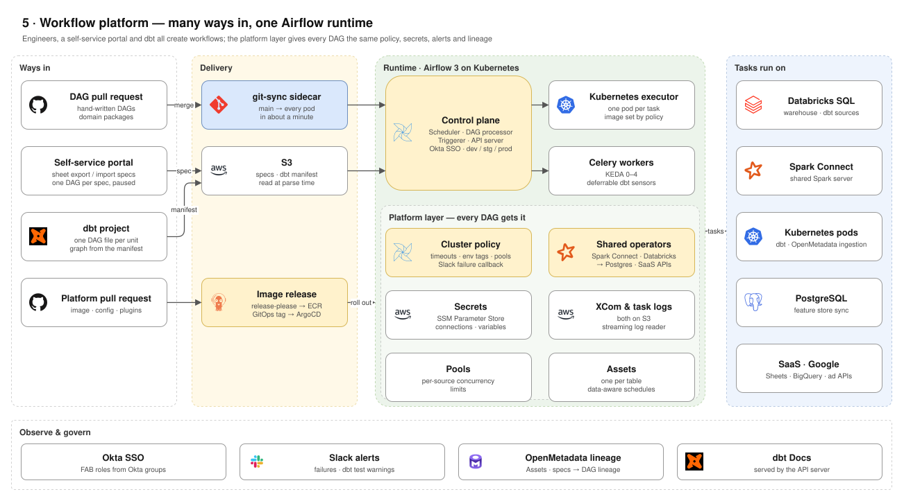

# Seongtae Jang (mungiyo)

**Data Engineer** — I build and run data platforms: CDC ingestion on Kafka, orchestration on Airflow, and serving on a lakehouse.

## What I build

The numbers on the diagram match the sections below.

<b>1 · CDC pipeline</b> — Kafka straight into the lakehouse, no landing layer

 

- Debezium topics are merged directly into Delta replicas by one Spark job every 10 minutes; the intermediate landing tables and their dedup step are gone.
- Schema changes (new table, new column, widened type) are applied by the job and announced on a topic, so nobody finds out from a broken model.
- Re-snapshots are a button in a self-service portal instead of a ticket.

<b>2 · Ingestion pipeline</b> — every batch source lands the same way

 

- Every non-CDC source — 3rd-party APIs, files, external storage — goes through the same pipeline: S3 landing → Bronze → Validate → Silver. Adding a source is a new instance of it, not new code.
- Landing files are never overwritten and Bronze keeps every column as STRING, so Silver can always be rebuilt from what was received.
- Write-Audit-Publish: each batch is typed, deduplicated and checked in a stage table first. Only a passing batch is published — a range replace by default, or a key MERGE inside a transaction. A failing batch is quarantined and Silver is left untouched.

<b>3 · feach</b> — feature store: pipelines write, one API reads

 

- Batch features: an Airflow operator diffs two Delta versions of a dbt mart and upserts only the changed rows into the online store.
- Real-time features: Flink jobs on one session cluster upsert from CDC and event topics; plain table copies go through a Kafka Connect JDBC sink.
- feach itself holds contracts and serves lookups. It never moves data, so every table has exactly one writer.

<b>4 · dbt CI/CD</b> — one commit SHA names both the image and the DAG graph

 

- Pull requests build only modified models into a throwaway schema, deferring everything else to production.
- A merge bakes the project into an image, publishes its manifest, then flips a pointer — in that order, so the pointer never names something that is not there.
- Airflow renders the DAG from that manifest and runs dbt from that image, so the graph and the code cannot drift.
- Related: [astronomer/astronomer-cosmos#2815](https://github.com/astronomer/astronomer-cosmos/pull/2815)

<b>5 · Workflow platform</b> — many ways in, one Airflow runtime

 

- Workflows come in four ways: hand-written DAGs merged to one repo, specs a self-service portal writes to S3 (one DAG per spec, e.g. Databricks → Google Sheets), dbt DAG files rendered from the manifest, and AI agents through an Airflow MCP that swaps the person's Okta token for their own Airflow token.
- Every DAG gets the same platform layer without asking: a cluster policy (timeouts, environment tags, pools, Slack failure alerts), shared operators, secrets from SSM Parameter Store, and XCom and task logs on S3.
- Delivery stays split. The platform image is versioned by release-please and promoted per environment through GitOps and ArgoCD; DAGs are pulled by a git-sync sidecar in every pod and are live in about a minute.
- Tables are Airflow Assets, so DAGs schedule on data and their lineage flows into OpenMetadata.
- Related: [apache/airflow#73517](https://github.com/apache/airflow/pull/73517) — the streaming S3 task-log reader

## Tech Stack

- **Ingestion** — Debezium CDC on Kafka Connect, custom SMTs, Iceberg sink
- **Processing** — Spark (Spark Connect on Kubernetes), Flink, dbt
- **Orchestration** — Airflow 3 on Kubernetes, dbt on Cosmos
- **Serving** — Databricks (Delta, Unity Catalog), feature store
- **Platform** — Kubernetes, ArgoCD, Terraform, OpenMetadata

## Open Source Contributions

- [apache/airflow#73517](https://github.com/apache/airflow/pull/73517) — Stream S3 remote task logs (peak heap 1,169 → 30 MiB)
- [astronomer/astronomer-cosmos#2815](https://github.com/astronomer/astronomer-cosmos/pull/2815) — Atomic writes for the dbt partial-parse cache
- [datahub-project/datahub#5918](https://github.com/datahub-project/datahub/issues/5918) — Tableau ingestion bug report
